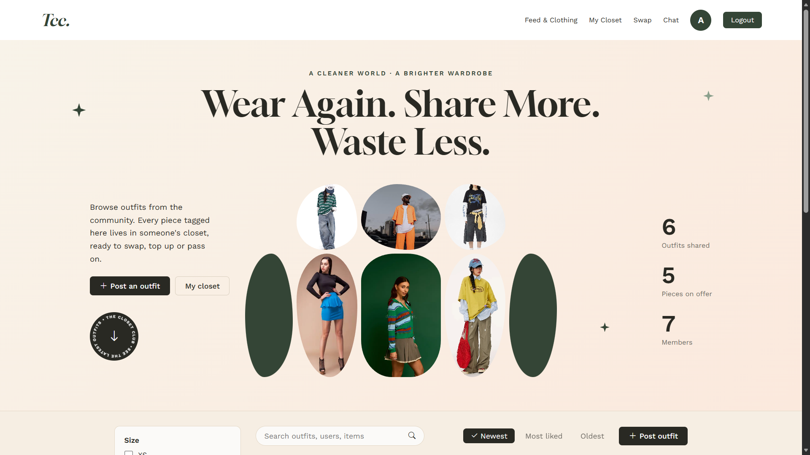
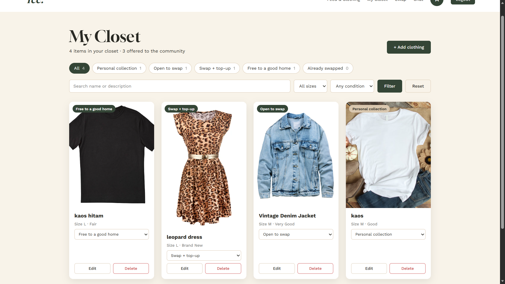
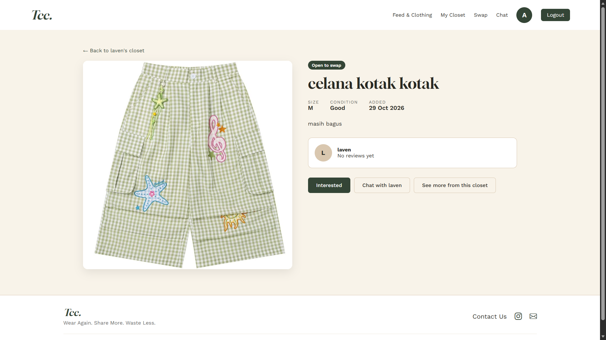
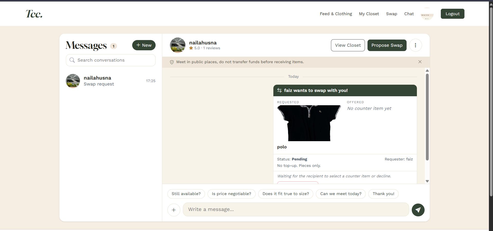
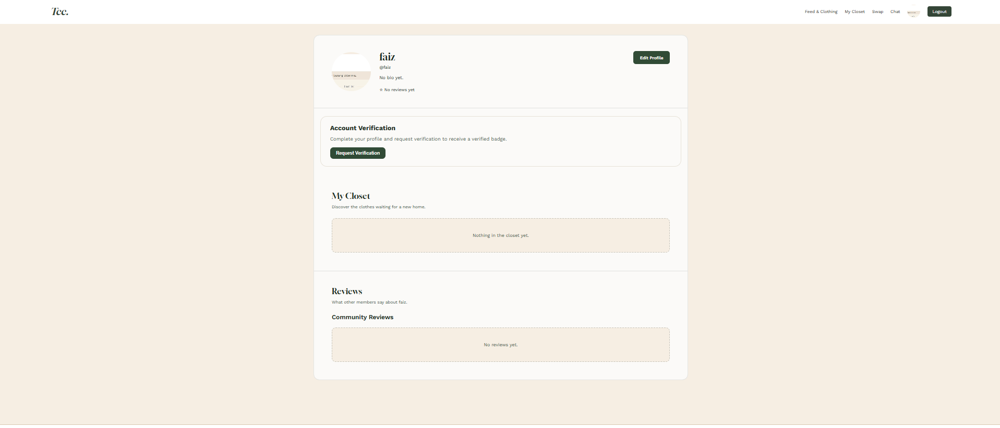

# The Closet Club (TCC)

**Platform Fashion Komunitas untuk Mendukung Gerakan Slow Fashion dan Conscious Shopping.**

The Closet Club (TCC) adalah platform media sosial dan barter busana yang menghubungkan para pecinta gaya hidup berkelanjutan (*sustainable living*). TCC memfasilitasi pertukaran pakaian (*swap/barter*), katalog lemari digital (*digital closet*), inspirasi *outfit feed*, dan komunikasi langsung guna memperpanjang usia pakai pakaian serta menekan limbah tekstil.

[**Aplikasi The Closet Club**](https://faiz-yusuf51-the-closet-club.pws.cs.ui.ac.id) · [**Desain Figma**](https://www.figma.com/team_invite/redeem/KOtMSHkQUlfOvsd0sgdnDd?t=FXv8TF02EvT69n4W-21)

---

## Daftar Isi

- [Gambaran Umum Proyek](#gambaran-umum-proyek)
- [Target Pengguna](#target-pengguna)
- [Permasalahan yang Diatasi](#permasalahan-yang-diatasi)
- [Manfaat Bagi Masyarakat](#manfaat-bagi-masyarakat)
- [Fitur Utama](#fitur-utama)
- [Peran Pengguna](#peran-pengguna)
- [Screenshot dan Demonstrasi](#screenshot-dan-demonstrasi)
- [Teknologi dan API](#teknologi-dan-api)
- [Panduan Instalasi](#panduan-instalasi)
- [Menjalankan Pengujian](#menjalankan-pengujian)
- [Modul Proyek dan Anggota Tim](#modul-proyek-dan-anggota-tim)
- [Desain Proyek](#desain-proyek)
- [Deployment](#deployment)
- [AI Disclosure](#ai-disclosure)

---

## Gambaran Umum Proyek

Industri *fast fashion* mendorong kebiasaan konsumtif yang menghasilkan jutaan ton limbah pakaian setiap tahunnya. Banyak pakaian berkualitas baik berakhir menumpuk di lemari dan jarang terpakai.

**The Closet Club (TCC)** hadir sebagai solusi *circular fashion* berbasis komunitas. Melalui platform ini, pengguna dapat:
1. Membagikan inspirasi *outfit* harian pada feed sosial media.
2. Mengatalogkan koleksi busana pribadi ke dalam *digital closet*.
3. Menandai pakaian tertentu untuk dibarter (*swap*), ditukar tambah, atau dilepas kepada pengguna lain.
4. Mencari tempat melalui OpenStreetMap Nominatim dan membagikan lokasi pilihan di dalam chat untuk membantu mengatur serah terima secara langsung.

Setiap unggahan *outfit* dapat ditautkan langsung dengan item pakaian dari *digital closet*. Jika pengguna lain tertarik, mereka dapat melihat kondisi detail barang, memulai obrolan (*chat*), mengajukan permohonan barter, hingga memberikan ulasan reputasi setelah transaksi selesai.

---

## Target Pengguna

1. **Peminat Pakaian Bekas / Thrifting:** Individu yang gemar berburu pakaian *vintage*, unik, atau *pre-loved* berkualitas tanpa harus membeli produk baru.
2. **Pemilik Pakaian Jarang Pakai:** Orang-orang yang ingin melakukan *decluttering* lemari pakaian secara ramah lingkungan dan bernilai manfaat.
3. **Komunitas Sustainable Living:** Masyarakat dan penggiat lingkungan yang peduli pada isu krisis iklim dan pengurangan jejak karbon dari limbah tekstil.

---

## Permasalahan yang Diatasi

- **Limbah Tekstil Rumah Tangga:** Mengurangi pakaian layak pakai yang berakhir di tempat pembuangan akhir (TPA) dengan memfasilitasi sirkulasi kembali antar-pengguna.
- **Konsumsi Pakaian yang Boros (*Fast Fashion Trap*):** Memberikan alternatif pemenuhan kebutuhan berpakaian tanpa biaya tinggi melalui mekanisme barter/tukar barang.
- **Rasa Ragu dalam Transaksi Pre-loved:** Menyediakan sistem reputasi berbasis ulasan transaksi nyata dan badge verifikasi akun. Pengguna dapat mencari tempat dan berbagi lokasi melalui chat untuk mengatur serah terima.

---

## Manfaat Bagi Masyarakat

1. Memperpanjang usia pakai pakaian (*lifecycle extension*) dan menekan volume sampah kain.
2. Memudahkan pencarian busana *secondhand/thrift* yang terkurasi langsung dari sesama anggota komunitas.
3. Menumbuhkan kesadaran kolektif seputar *slow fashion*, konsumsi sadar (*conscious shopping*), dan ekonomi sirkular.

---

## Fitur Utama

### 1. Login, Profile, & Reputation (`accounts`)
Mengelola sistem identitas akun pengguna, keamanan sesi, penanda verifikasi resmi, serta penilaian kredibilitas berbasis transaksi.
- **Extended User & Validation:** Memperluas `AbstractUser` dengan field kustom seperti foto profil, status centang biru (`is_verified`), bio, dan lokasi domisili. Dilengkapi validasi kelayakan data (nama lengkap dan email valid) sebelum permohonan verifikasi diproses.
- **Sinkronisasi Atomik & Race Condition Protection:** Alur persetujuan verifikasi akun oleh admin diamankan menggunakan transaksi database atomik (`transaction.atomic`) dan penguncian baris data (`select_for_update`) guna mencegah manipulasi identitas saat status diubah menjadi *Approved*. Sinyal otomatis (`post_delete`) mencabut status centang biru seketika jika catatan verifikasi dihapus.
- **Field Locking pada Profil Terverifikasi:** Pada formulir edit profil, pengguna yang telah berstatus terverifikasi secara otomatis dikunci akses pengubahan nama depan, nama belakang, dan emailnya untuk mencegah pemalsuan identitas.
- **Live Reputation Aggregation:** Perhitungan rata-rata bintang reputasi dihitung secara langsung di tingkat basis data (`Avg`) dan dibulatkan 1 desimal. Validasi tingkat model mencegah pengguna memberikan ulasan ke akun miliknya sendiri.

### 2. Feed & Clothing Post (`feed`)
Kanal interaksi sosial utama yang menampilkan inspirasi busana harian dan pakaian yang tersedia untuk pertukaran.
- Menjelajahi katalog foto *outfit* dan busana dengan kartu pakaian yang informatif (nama, ukuran, kondisi, foto, deskripsi, pemilik, dan status).
- Fitur pencarian dan filter pakaian berdasarkan kategori, ukuran, atau status ketersediaan.
- Tombol integrasi *"Interested"* yang mengarahkan penjelajah langsung ke lemari digital pemilik pakaian.

### 3. Lemari Digital (*My Closet*) (`closet`)
Ruang personal bagi setiap pengguna terdaftar untuk menginventarisasi pakaian mereka.
- Operasi CRUD penuh: menambah pakaian baru dengan foto dan deskripsi kondisi, memperbarui detail ketersediaan, serta menghapus pakaian yang sudah tidak tersedia.
- Pengaturan penandaan status pakaian: untuk koleksi pribadi, tersedia untuk barter (*available for swap*), atau sudah terbarter (*swapped*).

### 4. Percakapan Langsung (*Chat*) (`chat`)
Sistem komunikasi privat antarpengguna untuk membahas detail pakaian sebelum pertukaran disepakati. Pesan diperbarui melalui polling pada ruang chat.
- Daftar riwayat percakapan (*conversation list*) dan ruang obrolan (*chat room*).
- Mendukung pesan teks, balasan pesan, foto dan dokumen, berbagi lokasi, serta kartu permintaan swap.
- Pengguna dapat memblokir akun atau melaporkan percakapan yang bermasalah.
- Diskusi seputar ukuran riil, kondisi detail cacat/noda, negosiasi penukaran, hingga penentuan waktu temu.

### 5. Barter & Pertukaran (*Swap / Barter*) (`swap`)
Manajemen siklus hidup transaksi barter busana dari pengajuan hingga selesai.
- Alur transaksi terstruktur: pemilihan item yang diinginkan $\rightarrow$ penawaran item penukar $\rightarrow$ status permintaan (*Pending*, *Counter offered*, *Accepted*, *In progress*, *Declined*, *Cancelled*, *Completed*).
- Proteksi ulasan reputasi: formulir ulasan hanya dapat diisi jika status transaksi tukar telah resmi *Completed*.

---

## Peran Pengguna

| Peran | Hak Akses | Aksi yang Diizinkan | Aksi yang Dibatasi |
|---|---|---|---|
| **Tamu (*Guest / Anonymous*)** | *Read-only* pada konten publik | Menjelajahi *feed outfit*, melihat lemari digital publik pengguna lain, menggunakan bilah pencarian & filter barang. | Mengunggah pakaian/outfit, mengakses menu obrolan (*chat*), mengajukan barter pakaian, memberikan ulasan/rating, mengedit profil. |
| **Pengguna Terdaftar (*Registered User*)** | Hak penuh (*Authenticated*) | Seluruh akses tamu, mengunggah pakaian ke *My Closet*, memposting ke *feed*, mengirim pesan via *chat*, mengajukan permohonan *swap*, mengajukan verifikasi akun, serta memberi ulasan transaksi. | Mengubah status verifikasi secara mandiri tanpa persetujuan admin panel. |

---

## Screenshot dan Demonstrasi

> *Catatan: Lampirkan gambar visual antarmuka dan GIF demonstrasi aplikasi pada direktori `docs/screenshots/` dan `docs/gifs/`.*

### Halaman Feed Inspirasi Outfit
Tampilan *feed* utama yang memperlihatkan inspirasi gaya busana dari komunitas.


### Lemari Digital (My Closet)
Manajemen katalog koleksi busana pribadi dan pakaian yang dibuka untuk barter.


### Detail Pakaian & Tombol Interested
Informasi spesifikasi bahan, ukuran, kondisi, dan status ketersediaan pakaian.


### Ruang Percakapan (Chat Room)
Interaksi pesan langsung antarpengguna untuk bernegosiasi sebelum pertukaran disetujui.


### Alur Pengajuan Swap / Barter
Antarmuka pemilihan barang yang ditawarkan dan pelacakan status kesepakatan tukar.


### Profil Pengguna & Ulasan Reputasi
Halaman profil yang menampilkan badge terverifikasi dan kalkulasi bintang ulasan.


---

## Teknologi dan API

### Teknologi yang Digunakan (*Technology Stack*)

- **Backend:** Python (v3.10+) dan Django Framework (v5.x).
- **Frontend:** HTML5, CSS3, JavaScript, dan Bootstrap Icons.
- **Penyimpanan Media & Gambar:** Cloudinary Object Storage melalui `django-cloudinary-storage` (memastikan berkas media pengguna tetap persisten dan andal pada lingkungan *stateless/ephemeral*).
- **Database:**
  - SQLite untuk lingkungan pengembangan lokal (*development*).
  - PostgreSQL untuk lingkungan penerapan *production* di PWS.
- **WSGI / Web Server:** Gunicorn & WhiteNoise (pengelolaan berkas statis terkompresi).

### Integrasi API Publik (*Public API*)

- **OpenStreetMap Nominatim:**
  - Digunakan untuk mencari tempat berdasarkan kata kunci, dengan opsi kategori stasiun, minimarket, atau halte, lalu membagikan hasil sebagai pesan lokasi di chat.
  - Lokasi serah terima dipilih dan disepakati oleh pengguna. Aplikasi tidak menghitung titik tengah otomatis atau menjamin keamanan tempat.
  - [Dokumentasi pencarian Nominatim](https://nominatim.org/release-docs/latest/api/Search/)

---

## Panduan Instalasi

Ikuti petunjuk di bawah ini untuk menjalankan The Closet Club pada komputer lokal Anda.

### Prasyarat
- Python 3.10 atau versi yang lebih baru.
- Git.
- Virtual Environment (`venv`).

### Langkah-langkah Menjalankan Aplikasi

**1. Clone repositori Git**
```bash
git clone <URL_REPOSITORY_TCC>
cd the-closet-club
```

**2. Buat dan aktifkan Virtual Environment**

- **Windows (PowerShell):**
  ```powershell
  python -m venv .venv
  .\.venv\Scripts\Activate.ps1
  ```
- **macOS / Linux:**
  ```bash
  python3 -m venv .venv
  source .venv/bin/activate
  ```

**3. Pasang seluruh dependensi proyek**
```bash
pip install -r requirements.txt
```

**4. Konfigurasikan Environment Variables**
Berkas `.env.example` yang tersedia hanya memuat `PRODUCTION=False`. Untuk menjalankan mode lokal, konfigurasi saat ini menggunakan SQLite dan `dev-only-key`; server development tidak memerlukan kredensial Cloudinary dari `.env`. Untuk production, atur `PRODUCTION=True`, `SECRET_KEY`, dan variabel koneksi PostgreSQL (`DB_NAME`, `DB_USER`, `DB_PASSWORD`, `DB_HOST`, `DB_PORT`, serta opsional `SCHEMA`). Periksa konfigurasi deployment sebelum menjalankan aplikasi di lingkungan publik.
```env
PRODUCTION=False
```

Variabel tambahan untuk deployment production: `PRODUCTION=True`, `SECRET_KEY`, `DB_NAME`, `DB_USER`, `DB_PASSWORD`, `DB_HOST`, `DB_PORT`, dan opsional `SCHEMA`.

**5. Jalankan migrasi basis data**
```bash
python manage.py migrate
```

**6. Buat akun Superuser (Admin)**
```bash
python manage.py createsuperuser
```

**7. Jalankan server pengembangan lokal**
```bash
python manage.py runserver
```
Buka peramban dan akses alamat: `http://127.0.0.1:8000/`

---

## Menjalankan Pengujian

Suite pengujian mencakup beberapa modul, antara lain hak akses, integritas model, formulir, alur swap dan chat, serta verifikasi akun.

Untuk menjalankan pengujian pada modul Akun, Autentikasi, dan Reputasi (`accounts`):
```bash
python manage.py test accounts
```

Untuk menjalankan pengujian pada seluruh modul di proyek The Closet Club:
```bash
python manage.py test
```

---

## Modul Proyek dan Anggota Tim

### Pembagian Modul Utama

| Modul | Penanggung Jawab | Deskripsi Tanggung Jawab |
|---|---|---|
| **Login, Profile, & Reputation** (`accounts`) | Ria Lavenia Kharissa — 2506543905 | Autentikasi pengguna, profil kustom, sistem pengajuan verifikasi akun, penguncian data profil, dan ulasan reputasi. |
| **Feed & Clothing Post** (`feed`) | Nauval Adiva Daneshwara — 2506623074 | Pengunggahan inspirasi outfit, katalog busana umum, filter/search item, serta tombol interaksi minat item. |
| **My Closet** (`closet`) | Nadya Alyssa Azzahra — 2506599270 | Manajemen inventaris pakaian pribadi pengguna (CRUD pakaian, status ketersediaan barter). |
| **Chat** (`chat`) | Faiz Yusuf Elriki — 2506607921 | Sistem percakapan privat antarpengguna sebelum transaksi tukar, dengan pembaruan pesan melalui polling. |
| **Swap / Barter** (`swap`) | Naila Husna Teguh Suasono — 2506620444 | Alur pengajuan tukar busana, negosiasi barter barang, dan penentuan kesepakatan akhir. |

### Modul Bersama / Integrasi Global

| Komponen Bersama | Kontributor | Deskripsi Implementasi |
|---|---|---|
| **Global Layout & Navigation** | Ria Lavenia Kharissa | Templating modular (`base.html`, `base.css`), navigasi responsif, dan footer sederhana dengan identitas palet warna TCC. |
| **Integrasi OpenStreetMap (pencarian lokasi)** | Faiz Yusuf Elriki | Pencarian tempat melalui Nominatim dan pengiriman nama tempat, alamat, serta koordinat sebagai pesan lokasi di chat. Pengguna menentukan sendiri tempat serah terima; aplikasi tidak menghitung titik tengah otomatis. |

---

## Desain Proyek

Referensi desain purwarupa (*wireframe* dan *high-fidelity mockups*) aplikasi The Closet Club tersedia pada tautan Figma berikut:

[**Buka Desain The Closet Club di Figma**](https://www.figma.com/team_invite/redeem/KOtMSHkQUlfOvsd0sgdnDd?t=FXv8TF02EvT69n4W-21)

---

## Deployment

Aplikasi The Closet Club telah dideploy dan dapat diakses publik melalui Platform Web Service (PWS) Fasilkom UI:

**Tautan Aplikasi Aktif:** [https://faiz-yusuf51-the-closet-club.pws.cs.ui.ac.id](https://faiz-yusuf51-the-closet-club.pws.cs.ui.ac.id)

---

## AI-Disclosure

Berikut adalah dokumentasi keterbukaan penggunaan kecerdasan buatan (*AI Tool Usage & Disclosure*) dalam perancangan dan implementasi proyek **The Closet Club**:

### 1. Modul 1: Login, Profile, & Reputation
- **Nama & NPM**: Ria Lavenia Kharissa — 2506543905
- **Tool AI**: Claude, Gemini, ChatGpt
- **Link Chat**: [Tautan Claude](https://claude.ai/share/20dab666-0400-4e4a-937f-40371e62568b), [Tautan Gemini 1](https://share.gemini.google/WYEKnEZrj8YY), [Tautan Gemini 2](https://share.gemini.google/qPdR4hLMRGg0)

- **Cakupan Penggunaan**:
  - Perancangan arsitektur database `User` (turunan `AbstractUser`), `Verification`, dan `Review`.
  - Pembuatan kalkulasi reputasi pengguna via Django database aggregation (`Avg`).
  - Integrasi penyimpanan media Cloudinary.
  - Pengujian Unit Test Admin `AccountUserAdminTests` (meliputi penambahan user admin, validasi ReadOnlyPasswordHashField, integritas field profil kustom, dan pergantian password admin) di-generate secara penuh menggunakan bantuan AI (ChatGpt), yang kemudian diverifikasi dan dieksekusi secara manual hingga berstatus *passed* (OK).
- **Keterbatasan & Penyesuaian Manual**:
  - Penyesuaian manual dilakukan pada penanganan *reverse accessor clashes* pada model `User`.
  - Penanganan File Statis & Media: Kode awal AI menggunakan penyimpanan lokal bawaan (media/), yang menyebabkan gambar hilang ketika kontainer PWS di-deploy ulang. Penyesuaian ke Cloud Object Storage (Cloudinary) memerlukan konfigurasi arsitektur manual dengan bantuan AI.
  - Inkonsistensi penggunaan bahasa, sehingga diperlukan penyesuaian secara manual.

  Selain dari hal diatas, saya menggunakan [website PBP](https://pbp.cs.ui.ac.id/) untuk mengerjakan modul ini. Saya juga menggunakan beberapa sumber website yaitu [GeeksForGeeks](https://www.geeksforgeeks.org/), [Django documentation](https://docs.djangoproject.com/en/6.1/).


---

### 2. Modul 2: Feed & Clothing Post
- **Nama & NPM**: Nauval Adiva Daneshwara — 2506623074
- **Tool AI**: ChatGPT / Claude / Gemini
- **Link Chat**: [Tautan Riwayat Percakapan AI Modul 2](tulis linknya disini)
- **Cakupan Penggunaan**:
  - 
- **Keterbatasan & Penyesuaian Manual**:
  - 

---

### 3. Modul 3: My Closet
- **Nama & NPM**: Nadya Alyssa Azzahra — 2506599270
- **Tool AI**: Claude
- **Link Dokumentasi**: [Tautan Riwayat Percakapan AI Modul 3](https://chatgpt.com/share/xxxx-link-modul-3)
- **Cakupan Penggunaan**:
  - 
- **Keterbatasan & Penyesuaian Manual**:
  - 

---

### 4. Modul 4: Chat
- **Nama & NPM**: Faiz Yusuf Elriki — 2506607921
- **Tool AI**: ChatGPT / Claude / Gemini
- **Link Chat**: [Tautan Riwayat Percakapan AI Modul 4](https://chatgpt.com/share/xxxx-link-modul-4)
- **Cakupan Penggunaan**:
  - 
- **Keterbatasan & Penyesuaian Manual**:
  - 

---

### 5. Modul 5: Swap / Barter & Integrasi API
- **Nama & NPM**: Naila Husna Teguh Suasono — 2506620444
- **Tool AI**: ChatGPT / Claude / Gemini
- **Link Chat**: [Tautan Riwayat Percakapan AI Modul 5](https://chatgpt.com/share/xxxx-link-modul-5)
- **Cakupan Penggunaan**:
  - 
- **Keterbatasan & Penyesuaian Manual**:
  - 